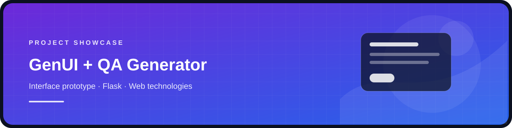

<div align="center">
  
  <h1>GenUI + Question Answer Pair Generator</h1>
  <p>  </p>
  <p>A combined showcase of the GenUI web-interface prototype and its related PDF question-answer generation prototype.</p>
</div>

## What is in this repository

- `interface/` — Flask app, HTML/CSS and image assets for the GenUI interface prototype.
- `question-answer-pair-generator/` — Streamlit app that accepts a PDF, generates questions and retrieves answers with a Hugging Face model and LangChain.
- `tools/solidity_compile_demo.js` — a separate helper script from the GenUI source folder; it expects a `Demo.sol` file that was not included.

The two applications are grouped in one repository as requested, but the supplied Flask interface does not call the Streamlit question-answer app. They remain separate prototypes within one project repository.

## Run the GenUI interface

```bash
cd interface
python -m venv .venv
# Activate the environment, then:
pip install Flask
python app.py
```

Open `http://127.0.0.1:3000` in a browser. The interface is a front-end prototype and does not include a connected generation backend.

## Run the question-answer prototype

```bash
cd question-answer-pair-generator
python -m venv .venv
# Activate the environment, then:
pip install -r requirements.txt
streamlit run app.py
```

The app downloads its Hugging Face model on first use and can require substantial memory. Its LangChain imports and unpinned dependencies come from an older API generation, so dependency compatibility may need adjustment in a modern Python environment.

## Notes

- Virtual environments, local data and student reference PDFs are excluded.
- The Solidity helper is not part of either app; it needs `solc` plus a local `Demo.sol` file.
